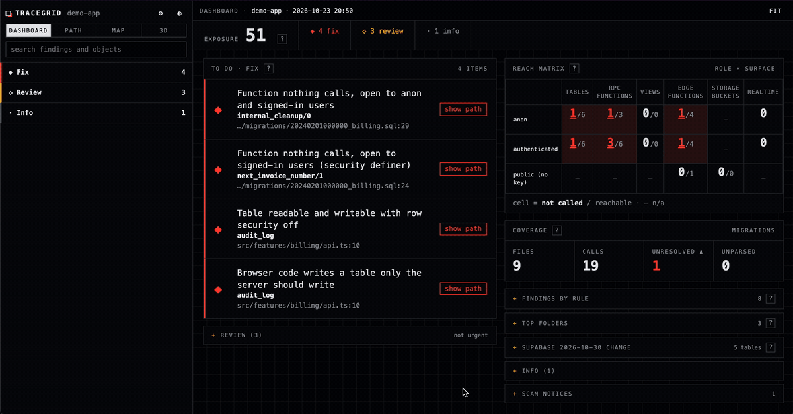

<div align="center">

# tracegrid

**Map every path from your app's code to its database, and catch what's exposed but never used.**

[](https://www.npmjs.com/package/tracegrid)
[](https://github.com/EdanBarrios/tracegrid/actions)
[](LICENSE)




</div>

Supabase and Firebase (including Flutter apps). Static, offline, no AI, no telemetry. Checked by hand on public apps: 111 of 113 Fix findings held up on 20 Supabase apps, and 75 of 75 on 70 Firebase apps ([benchmarks](BENCHMARKS.md)). v0.x, best effort: read [Limitations](#limitations) before acting on a finding.

## What it finds

| Finding | Example | Tier |
|---|---|---|
| Exposed function nothing calls | `internal_cleanup()` executable by `anon`, no caller | Fix |
| Client-read table without RLS | `from('audit_log')` with RLS off | Fix |
| Owner-rights view over RLS tables | client reads a view without `security_invoker` | Fix |
| Missing RPC or edge function | `.rpc('get_totals')` not in the schema | Review |
| Edge function with no caller | `functions/old-sync` never invoked | Review |

Firebase (Firestore, Storage, Realtime Database, Cloud Functions; Dart and JS/TS):

| Finding | Example | Tier |
|---|---|---|
| Rule anyone can write through | `allow update, delete: if true` | Fix |
| User can grant themselves access | rules trust `users/{uid}.role`, and the owner may write `role` | Fix |
| Rule path open to clients, unused | `/billing/{id}` readable by signed-in users, no client code touches it | Fix |
| Callable function with no auth check | `onCall` handler never reads `request.auth` | Review |
| Callable function nothing calls | `onCall` export with no `httpsCallable` | Review |

All rules, tiers and examples: [docs/rules.md](docs/rules.md) and [docs/firebase.md](docs/firebase.md).

## Quickstart

```sh
npx tracegrid --demo
cd your-app && npx tracegrid
```

Output goes to `./tracegrid-out/` (`report.md`, `graph.json`, `graph.html`); see [Output](docs/output.md).

## Use it in CI

```yaml
on: pull_request
permissions:
  contents: read
jobs:
  tracegrid:
    runs-on: ubuntu-latest
    steps:
      - uses: actions/checkout@3d3c42e5aac5ba805825da76410c181273ba90b1 # v7.0.1
        with: { persist-credentials: false }
      - uses: actions/setup-node@949feb2413d6458794dcd2491c4babbbce0c15c1 # v7.1.0
        with: { node-version: 22 }
      - run: npx --yes tracegrid@0.3.0 --check --github --no-plugins
```

`--check` fails on any new Fix finding not in `tracegrid.baseline.json` (create it with `--update-baseline`). SARIF and more: [docs/ci.md](docs/ci.md).

## Use it with Claude Code

```sh
claude plugin marketplace add EdanBarrios/tracegrid
claude plugin install tracegrid@tracegrid
```

Other agents: `npx tracegrid --json` prints one JSON object (findings with `file:line`) for scripts and agent sessions; [docs/agents.md](docs/agents.md) has an `AGENTS.md` snippet. `npx tracegrid --serve --watch` serves the dashboard on localhost with a Refresh button.

## How it works

- Replays your Supabase migrations (or reads the live catalog with `--db-url`) to learn tables, functions, grants and RLS.
- Parses your code with the TypeScript parser to find `.from`, `.rpc`, `functions.invoke` and storage calls.
- Joins the two into one graph and reports exposure with no caller, in the reverse direction most tools skip.
- Firebase: parses Security Rules (rule functions inlined) and finds Firestore, Storage and callable-function references in Dart and JS/TS ([details](docs/firebase.md)).
- Writes `report.md`, `graph.json` and an offline `graph.html`.

## Limitations

- "Nothing calls it" means no call site tracegrid recognised; grep before revoking. [Details](docs/limitations.md)
- Static analysis without a type checker: findings are leads.
- Dynamic names, other languages and callers outside the repo are invisible.
- Migration replay is lossy; prefer `--db-url` for gating.
- `edge-service-role-before-auth` is a heuristic.
- Catalog mode (`--db-url`) is tested on macOS and Linux; on Windows it needs psql.exe on PATH.

[Docs](docs/README.md) · [Configuration](docs/configuration.md) · [Rules](docs/rules.md) · [Security](SECURITY.md) · [Changelog](CHANGELOG.md) · [Benchmarks](BENCHMARKS.md) · [Roadmap](ROADMAP.md) · [Contributing](CONTRIBUTING.md)

Not affiliated with Supabase or Google. MIT © Edan Barrios.
